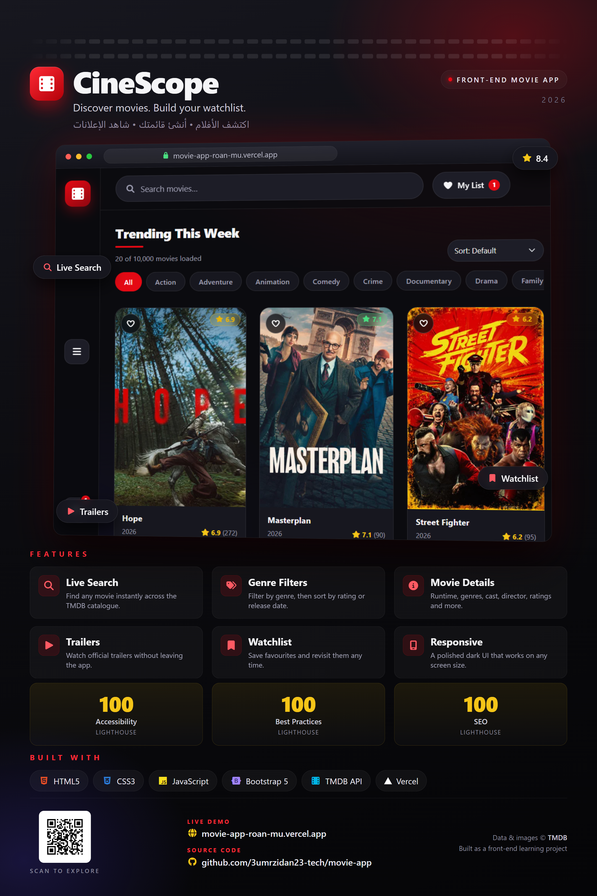

# 🎬 CineScope

A fast, responsive movie discovery app built with **HTML, CSS, vanilla JavaScript and Bootstrap 5**. Browse trending, now playing, popular, top rated and upcoming movies, search the TMDB catalogue, read details and ratings, and build your own watchlist.

**Live demo:** <https://movie-app-roan-mu.vercel.app>  
**Repository:** <https://github.com/3umrzidan23-tech/movie-app>

<p align="center">
  
</p>

> This product uses the TMDB API but is not endorsed or certified by TMDB.

## ✨ Features

- **5 movie sections** — Trending, Now Playing, Popular, Top Rated, Upcoming
- **Live search** with debounce, clear button and empty states
- **Genre filters** powered by the TMDB genres endpoint
- **Movie details modal** — backdrop, runtime, genres, rating, vote count, director, cast, trailer and "More like this"
- **Watchlist** saved in `localStorage` with a live counter
- **Rating colour coding** (green ≥ 7, yellow 5–7, red < 5)
- **Load More** pagination
- **Sorting** by rating or release date
- **Back to top** button on long pages
- **Sharing** via the Web Share API with clipboard fallback
- **Deep links** — `?movie=123` opens a movie directly
- **Skeleton loaders**, error states, retry buttons and toast notifications
- **Responsive dark UI**, keyboard accessible cards and skip link
- **Session cache** to avoid duplicate API calls
- **Hidden API key** — browser requests go through a small Vercel Function

## ✅ Quality checks

- Lighthouse (desktop, local build): **Accessibility 100 · Best Practices 100 · SEO 100**
- JavaScript files pass `node --check`
- No browser console errors during normal use

## 🧱 Tech stack

| Layer | Technology |
| --- | --- |
| Markup | HTML5 |
| Styling | CSS3 + Bootstrap 5.3 |
| Logic | Vanilla JavaScript (ES2020+) |
| Icons | Font Awesome 6 (local) |
| Data | [TMDB API v3](https://developer.themoviedb.org/docs) |
| API proxy | Vercel Function (Node.js) |
| Hosting | Vercel (Hobby / free) |

No build step and no framework. The only server-side code is one small function that adds the TMDB key and forwards the request.

## 🔄 How requests work

```
Browser
  ↓
/api/tmdb?path=/trending/movie/week&page=1
  ↓
Vercel Function  (api/tmdb.js → lib/tmdb-proxy.js)
  ↓  adds TMDB_API_KEY from environment variables
TMDB API
  ↓
JSON response → UI
```

- The key never reaches the browser.
- Only a safe allow-list of TMDB endpoints and query parameters is forwarded.
- Successful responses are cached on Vercel's CDN for 10 minutes and in `sessionStorage` per session.

## 📁 Project structure

```
.
├── index.html
├── api/
│   └── tmdb.js               # Vercel Function (production proxy)
├── lib/
│   └── tmdb-proxy.js         # Shared proxy + allow-list logic
├── dev-server.js             # Zero-dependency local server (dev only)
├── css/
│   ├── all.min.css           # Font Awesome
│   ├── bootstrap.min.css
│   └── style.css             # All custom styles
├── js/
│   ├── config.js             # API base URL and image sizes
│   ├── main.js               # App logic (API, UI, search, watchlist)
│   └── bootstrap.bundle.min.js
├── images/
│   ├── favicon.svg
│   └── placeholder.svg       # Fallback poster
├── .env.example
├── .gitignore
└── README.md
```

## 🚀 Run locally

Because the app calls `/api/tmdb`, opening `index.html` directly will not work. Use the included local server, which serves the static files **and** implements the same proxy.

### 1. Create your local environment file

```powershell
Copy-Item .env.example .env.local
```

Windows CMD:

```bat
copy .env.example .env.local
```

Open `.env.local` and add your TMDB key:

```
TMDB_API_KEY=your_tmdb_api_key_here
```

Get a free key from your [TMDB account settings](https://www.themoviedb.org/settings/api).

### 2. Start the app

```bash
node dev-server.js
```

Open <http://localhost:5500>.

`.env.local` is git-ignored and is never committed.

### Alternative: Vercel CLI

If you are logged in to Vercel, `npx vercel dev` runs the static site and the real `/api/tmdb` Function with your project environment variables.

## 🔑 API key

The TMDB key is **not** stored in the front-end code.

| Environment | Where the key lives |
| --- | --- |
| Local | `.env.local` (git-ignored) |
| Vercel | `TMDB_API_KEY` environment variable |

The browser only knows about `/api/tmdb`.

## ☁️ Deploy to GitHub + Vercel

### 1. Push to GitHub

```bash
git add .
git commit -m "Build CineScope movie discovery app"
git branch -M main
git remote add origin https://github.com/<your-username>/movie-app.git
git push -u origin main
```

### 2. Create the Vercel project

1. Go to <https://vercel.com/new> and sign in with GitHub.
2. Import the `movie-app` repository.
3. Framework preset: **Other**.
4. Build command: leave empty. Output directory: leave empty. Root directory: `./`.
5. Before the first deploy, open **Environment Variables** and add:
   - **Name:** `TMDB_API_KEY`
   - **Value:** your TMDB API key
   - **Environments:** Production, Preview and Development
6. Click **Deploy**.

Vercel detects `api/tmdb.js` automatically and gives you a URL such as `https://movie-app.vercel.app`.

Every push to `main` redeploys automatically. If you change the environment variable later, redeploy the project.

### 3. Optional: custom domain

In Vercel → Project → **Settings → Domains**, add your domain and follow the DNS instructions. The `*.vercel.app` domain is free.

## 🧪 Notes & limitations

- The contact form validates in the browser only; no message is sent anywhere.
- Watchlist and session cache use browser storage, so they are per-device.
- Only movies are supported (no TV shows yet).
- The UI is in English; an Arabic / RTL toggle is a possible future addition.
- TMDB rate limits apply. Responses are cached for 10 minutes on the CDN and per session.
- Vercel's Hobby plan is free for personal, non-commercial projects.
- Copyright / attribution: movie data and images © [TMDB](https://www.themoviedb.org/).

## 🗺️ Possible next steps

- TV shows support with a Movies / TV toggle
- Arabic UI + RTL layout
- A real contact endpoint (e.g. Formspree / Resend)
- PWA offline support
- Automated tests and ESLint

## 📄 License

MIT — free to use for learning and personal projects.
